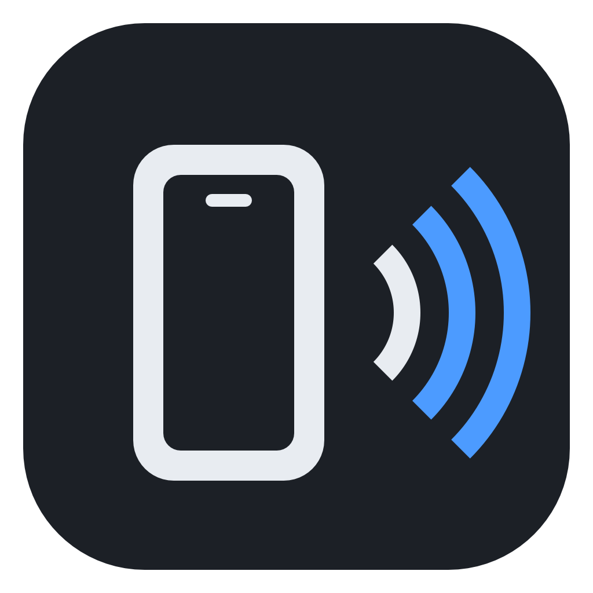
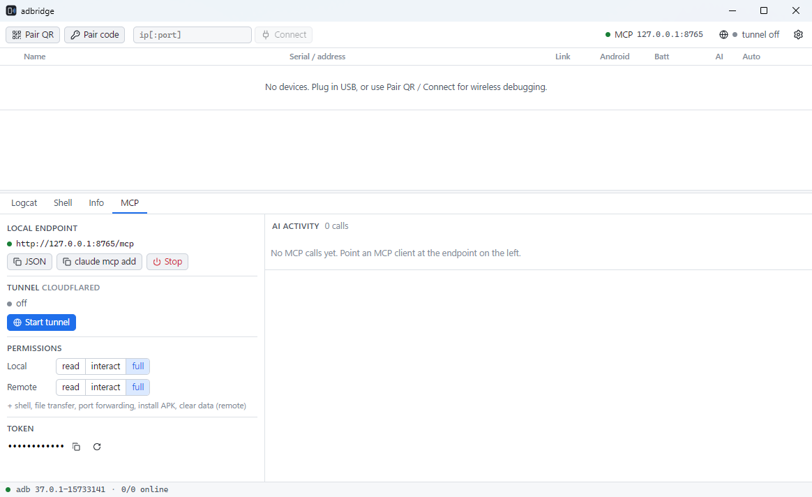
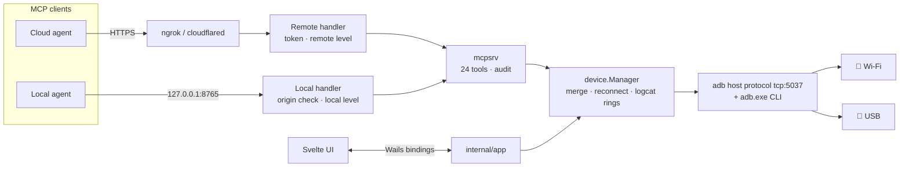

<div align="center">



# adbridge

**Keep Android phones connected over Wi-Fi, and let AI agents debug them through MCP, from your PC or from the cloud.**

[](https://github.com/a27259954/adbridge/actions/workflows/ci.yml)
[](https://github.com/a27259954/adbridge/releases/latest)
[](https://github.com/a27259954/adbridge/releases)
[](go.mod)
[](#requirements)
[](docs/mcp-tools.md)
[](LICENSE)

English · [繁體中文](docs/README.zh-TW.md)



</div>

---

adbridge is a single `adbridge.exe` for Windows. It needs only Android SDK Platform-Tools on the PC. It keeps any number of phones connected over Wi-Fi or USB and exposes them through a **Model Context Protocol** endpoint, so Claude, ChatGPT or any other MCP client can read logs, look at the screen, tap through the UI, move files and install builds. A built-in tunnel makes the endpoint reachable from cloud agents that cannot install anything themselves.

## Contents

- [Features](#features)
- [Requirements](#requirements)
- [Quick start](#quick-start)
- [Cloud agents](#cloud-agents)
- [MCP tools](#mcp-tools)
- [Security model](#security-model)
- [How it works](#how-it-works)
- [FAQ](#faq)
- [Building from source](#building-from-source)
- [Contributing](#contributing)

## Features

| | |
|---|---|
| 📶 **Wireless first** | Pair with a QR code or a 6-digit code (Android 11+), connect to `ip:port`, or switch a USB device to Wi-Fi in one click (any Android version). |
| 🔁 **Stays connected** | Wireless debugging picks a new port after every reboot. adbridge finds the phone again by its mDNS name and reconnects it. |
| 📱 **Many devices** | A phone on both USB and Wi-Fi is one row. Wi-Fi is preferred and USB takes over if Wi-Fi drops. Aliases make devices easy for an agent to address. |
| 🤖 **24 MCP tools** | Logcat queries from a live 20,000-line buffer, crash logs, screenshots and bursts, screen recording, a numbered UI tree, input, app control, file transfer, port forwarding, HTTP to device sockets, and shell. |
| 🌍 **One-click tunnel** | ngrok (embedded, fixed URL on a free account) or Cloudflare Quick Tunnel (no account). |
| 🛡️ **You stay in control** | Separate permission levels for local and remote clients, a per-device AI switch, an idle timeout, a kill switch, and a live log of every tool call. |
| 🪶 **Small footprint** | One ~18 MB exe. All data stays in your user profile, and the tool keeps running in the tray. |
| 🌐 **Localized** | English, 简体中文, 繁體中文, Español, 日本語, 한국어. The UI follows the Windows display language. |

## Requirements

- Windows 10 or 11 with the [WebView2 runtime](https://developer.microsoft.com/microsoft-edge/webview2/). Windows 11 already includes it.
- [Android SDK Platform-Tools](https://developer.android.com/tools/releases/platform-tools). adbridge finds `adb.exe` on `PATH`, in `ANDROID_HOME` / `ANDROID_SDK_ROOT`, or in the Android Studio SDK folder. You can also set the path in Settings.
- Phones: Android 11+ for QR or code pairing. Any version over USB, or over `tcpip` after **Switch USB → Wi-Fi**.

## Quick start

1. **Download** [`adbridge.exe`](https://github.com/a27259954/adbridge/releases/latest/download/adbridge.exe) and run it.
2. **Connect a phone.** Use one of these:
   - **Pair QR:** On the phone, go to *Developer options → Wireless debugging → Pair device with QR code* and scan.
   - **USB:** Plug in the phone and accept the RSA prompt. Then choose **⋯ → Switch USB → Wi-Fi** to cut the cable.
3. **Point your agent at it:**

   ```bash
   claude mcp add --transport http adbridge http://127.0.0.1:8765/mcp
   ```

   Or paste this into any MCP client config (the **MCP** tab copies it for you):

   ```json
   { "mcpServers": { "adbridge": { "type": "http", "url": "http://127.0.0.1:8765/mcp" } } }
   ```

4. Ask something like *"Open the app, log in with the test account and tell me why the profile screen crashes."*

## Cloud agents

Cloud sandboxes and hosted assistants can only call an HTTPS URL. adbridge gives them one:

1. Open **Settings → Tunnel** and choose a provider:
   - **ngrok:** Paste the authtoken from a free account and add your free static domain. The URL then never changes.
   - **cloudflared:** Needs no account. adbridge downloads the binary on first use and verifies its SHA-256. The URL changes every time.
2. Click **Start tunnel**. Copy the remote config (it uses an `Authorization: Bearer` header) or the **Secret URL** (`…/mcp/<token>`, for clients that cannot set headers).
3. Remote clients start at the **read** level. Raise the level only while you need it.

With `full`, a remote agent can run the whole loop on its own:

```text
build APK in its sandbox ─▶ upload_file (4 MiB chunks) ─▶ install_apk {upload_id}
      ─▶ app_start ─▶ ui_tree / tap ─▶ logcat · crash_log · pull_file · screenshot {count: 5}
```

Details: [docs/remote-access.md](docs/remote-access.md).

## MCP tools

| Level | Tools |
|---|---|
| **read** | `list_devices` `device_info` `logcat` `crash_log` `screenshot` `screenrecord` `ui_tree` `list_packages` `dumpsys` |
| **interact** | everything in read, plus `tap` `swipe` `input_text` `key` `app_start` `app_stop` `logcat_clear` `device_http` |
| **full** | everything in interact, plus `shell` `upload_file` `push_file` `pull_file` `port_forward` `install_apk` `app_clear` |

These tools are designed for agents:

- **`logcat` returns instantly.** It reads a buffer that is always streaming, filtered by level, tag, package, regex and time window.
- **`ui_tree` numbers elements** (`[12] Button "Log in" (540,1850) click`), so the agent taps `{element: 12}` instead of guessing pixels.
- **`screenshot` saves tokens.** It returns a downscaled JPEG and states the factor to convert coordinates back to device pixels. `count` gives a burst of frames for animations.
- **`device_http` reaches servers on the device,** such as Chrome DevTools, WebView debugging or an app's debug server, through adb without opening any port on the PC.

Full reference with arguments and workflows: [docs/mcp-tools.md](docs/mcp-tools.md).

## Security model

- The endpoint listens on `127.0.0.1` only. Remote access goes through the tunnel and **always** requires the token.
- Local requests are protected against DNS rebinding, and browser `Origin` headers from other sites are rejected.
- A request's origin (local or remote) comes from the listener that accepted it. Clients cannot spoof it, and a test covers this.
- The permission level is enforced per tool, the AI switch per device. Every call is written to `%LOCALAPPDATA%\adbridge\logs\audit-*.jsonl`.
- Inputs are validated before they reach adb, and file transfer uses the sync protocol instead of shell strings.

Read [docs/SECURITY.md](docs/SECURITY.md) before you give a remote client `full`.

## How it works



| Package | Responsibility |
|---|---|
| `internal/adb` | Thin adb client: host protocol (tracking, shell v2, exec, sync file transfer, device sockets) plus the CLI for pair, connect, mDNS and forward. Ships a fake adb server for tests. |
| `internal/device` | Merges transports by `ro.serialno`, remembers and reconnects devices, keeps logcat ring buffers, provides UI tree, input, screenshot and recording helpers. |
| `internal/mcpsrv` | MCP tools, permission gate, auth middleware, output limits. |
| `internal/tunnel` | ngrok (embedded SDK) and cloudflared providers, idle timeout. |
| `internal/staging` | Chunked uploads for remote agents. |
| `internal/pairing` | QR pairing through the adb server's mDNS. |
| `internal/app` | The only package that imports Wails: services, events, tray, i18n. |
| `frontend/` | Svelte 5 + TypeScript with plain CSS tokens and no UI kit. |

Everything adbridge writes lives under `%APPDATA%\adbridge` (settings) and `%LOCALAPPDATA%\adbridge` (devices, logs, uploads, recordings, WebView profile). To uninstall, delete those two folders and the exe.

## FAQ

<details>
<summary><b>Does a cloud agent get the same control as a local one?</b></summary>

On the phone, yes: at the `full` level it has the same 24 tools. It cannot reach ports on your PC, so use `device_http` for servers on the device. Some steps still need a person: unlocking the screen, accepting the RSA prompt, re-enabling Wireless debugging after the phone switches Wi-Fi networks, and `FLAG_SECURE` screens, which capture as black.
</details>

<details>
<summary><b>Wireless debugging keeps turning off.</b></summary>

Android turns it off when the phone joins a different Wi-Fi network. Some vendors also turn it off after a reboot. Keep the phone on one network. As a fallback, plug it in once and use **Switch USB → Wi-Fi**, which uses the classic `tcpip 5555` mode.
</details>

<details>
<summary><b>"adb server version doesn't match this client"</b></summary>

Another tool, such as Android Studio or scrcpy, started the adb server with a different `adb.exe`. adbridge never kills the server, so point **Settings → adb.exe path** at the same Platform-Tools that your other tools use.
</details>

<details>
<summary><b>Where is my token stored? Is it encrypted?</b></summary>

It is stored in plain text in `%APPDATA%\adbridge\config.json`, which only your Windows account can read. This is a deliberate trade-off, explained in [docs/SECURITY.md](docs/SECURITY.md). You can rotate it from the MCP tab.
</details>

<details>
<summary><b>Windows SmartScreen warns about the exe.</b></summary>

Release builds are not code-signed yet. Check the file against the `adbridge.exe.sha256` published with each release, then choose *More info → Run anyway*.
</details>

## Building from source

Requirements: Go 1.25+, Node 20+, and the Wails v3 CLI.

```bash
go install github.com/wailsapp/wails/v3/cmd/wails3@v3.0.0-beta.28
```

```bash
wails3 build
```

The output is `bin/adbridge.exe`. During development, use hot reload:

```bash
wails3 dev
```

To run vet, the tests and the frontend type check:

```bash
wails3 task check
```

Every push to `main` publishes a release automatically. See [docs/CONTRIBUTING.md](docs/CONTRIBUTING.md#releases).

## Contributing

Issues and PRs are welcome. Please read [docs/CONTRIBUTING.md](docs/CONTRIBUTING.md) first: the project deliberately stays small and focused. Report security problems privately as described in [docs/SECURITY.md](docs/SECURITY.md).

## License

[MIT](LICENSE) © 2026 a27259954
