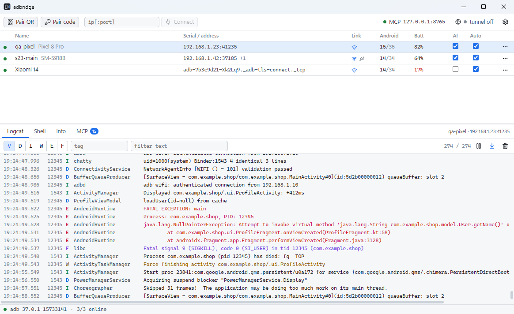

# adbridge

**一個精簡的 Windows 工具：讓 Android 手機穩定保持 Wi-Fi 連線，並透過 MCP 讓 AI 偵錯手機，不論 AI 在本機或在雲端都可以。**

`adbridge.exe` 是單一執行檔，電腦上只需要裝好 Android SDK Platform-Tools（`adb`）。

[English](../README.md)

<p align="center"></p>

## 功能

- **以無線為主，也支援 USB**：可以用 QR code 配對（Android 11+）、用 6 位數配對碼配對、直接連 `ip:port`，或把 USB 裝置一鍵切到 Wi-Fi（所有 Android 版本都適用）。
- **多裝置同時連線**：同一台手機同時接 USB 和 Wi-Fi 時，只會顯示成一列。優先走 Wi-Fi，USB 當備援。
- **斷線自動重連**：手機重開機後，無線偵錯的 port 會改變。adbridge 會用 mDNS 名稱重新找到裝置，再自動連回去。
- **內建 MCP server**：用 Streamable HTTP 協定，位址是 `http://127.0.0.1:8765/mcp`，提供 24 個 tool，涵蓋 logcat 查詢、崩潰紀錄、截圖與錄影、帶編號的 UI 樹、點擊/滑動/輸入、App 控制、檔案傳輸、port 轉發、對裝置 socket 發 HTTP 請求、dumpsys 和 shell。
- **一鍵開放遠端存取**：用內建的 tunnel 讓無法安裝任何東西的雲端 AI 也能連進來。可選 ngrok（已內嵌在 exe 裡）或 Cloudflare Quick Tunnel（不需要帳號）。
- **權限掌握在自己手上**：本機和遠端各自設定權限等級，也可以逐台決定哪些裝置開放給 AI。所有 tool 呼叫都會記錄在「AI 操作紀錄」裡。
- **多國語言介面**：支援 English、简体中文、繁體中文、Español、日本語、한국어。預設跟隨 Windows 顯示語言，也可以在設定裡切換。給 AI 看的 MCP tool 說明一律維持英文。

## 需求

- Windows 10/11，需要 WebView2 Runtime（Windows 11 已內建）。
- [Android SDK Platform-Tools](https://developer.android.com/tools/releases/platform-tools)。adbridge 會依序到 `PATH`、`ANDROID_HOME` / `ANDROID_SDK_ROOT`、Android Studio 預設的 SDK 資料夾尋找 `adb.exe`，也可以在設定裡手動指定路徑。

## 快速開始

1. 從 [Releases](https://github.com/a27259954/adbridge/releases/latest) 下載 `adbridge.exe` 並執行。
2. 連接手機：
   - **QR 配對**：在手機上進入「開發人員選項 → 無線偵錯 → 使用 QR code 配對裝置」，然後在 adbridge 按 **Pair QR** 掃描畫面上的 QR code。
   - **USB**：插上 USB 線並在手機上允許 RSA 授權。想改成無線的話，點 **⋯ → Switch USB → Wi-Fi**。
3. 讓 MCP client 連到 adbridge：

   ```bash
   claude mcp add --transport http adbridge http://127.0.0.1:8765/mcp
   ```

   MCP 分頁裡有按鈕可以直接複製 JSON 設定和上面這行指令。

### 雲端 AI（遠端存取）

1. 到 **Settings → Tunnel** 選擇 provider：
   - **ngrok**（推薦）：註冊免費的 [ngrok](https://dashboard.ngrok.com) 帳號，把 authtoken 貼進來。再填入免費的 static domain，網址就會固定不變。
   - **cloudflared**：不需要帳號。第一次使用時，adbridge 會從 Cloudflare 的 GitHub Release 下載執行檔，並用 GitHub 公布的 SHA-256 驗證。缺點是每次啟動網址都會不同。
2. 在 MCP 分頁按 **Start tunnel**，然後複製遠端設定（使用 `Authorization: Bearer` header），或複製 **Secret URL**（`…/mcp/<token>` 格式，給無法自訂 header 的 client 用）。
3. 遠端 client 預設是 **read** 權限，需要時再臨時調高。tunnel 預設閒置 30 分鐘後會自動關閉。

### 雲端 AI 也能跑完整個偵錯流程

雲端 AI 只連得到 MCP，所以整個流程的每一步都做成了 tool：

- **建置後安裝**：雲端 AI 在自己的環境建好 APK，用 `upload_file` 每段 4 MiB 分段上傳，再呼叫 `install_apk {upload_id}` 安裝。
- **雙向傳檔**：`push_file` 把測試資料或設定檔寫到手機；`pull_file` 讀取 traces、prefs 或資料庫副本。文字檔直接回傳文字，二進位檔以可分頁的 resource 回傳。
- **裝置端的 server**：`device_http` 透過 adb 連到 Chrome DevTools、WebView 的偵錯 socket 或 App 自己的偵錯 server，電腦不需要開任何 port。
- **觀察動態畫面**：`screenshot {count, interval_ms}` 連拍多張，任何能看圖的模型都能用；`screenrecord` 錄成 MP4，存在電腦上並回傳給 client。

仍然需要人處理的情況：解鎖手機、允許 RSA 授權、手機換 Wi-Fi 後重新開啟無線偵錯，以及開了 `FLAG_SECURE` 的畫面（截圖會是黑的）。互動式除錯器（JDWP、lldb）需要直接的 socket 連線，實際上只有在電腦本機的 client 能透過 `port_forward` 使用。

## 檔案位置

發佈的只有 `adbridge.exe`。程式寫入的所有東西都放在使用者目錄底下：

| 路徑 | 內容 |
|---|---|
| `%APPDATA%\adbridge\config.json` | 設定，包含 MCP token 和 ngrok authtoken（明文儲存，只有你的 Windows 帳號能讀取） |
| `%LOCALAPPDATA%\adbridge\devices.json` | 記住的裝置、別名、AI 開關、自動重連設定 |
| `%LOCALAPPDATA%\adbridge\bin\` | `cloudflared.exe`（只有使用該 provider 時才會下載） |
| `%LOCALAPPDATA%\adbridge\logs\` | `app.log` 和每天一份的 `audit-YYYY-MM-DD.jsonl` |
| `%LOCALAPPDATA%\adbridge\uploads\` | `upload_file` 暫存的檔案（每次啟動都會清空，單一上傳 1 小時後過期） |
| `%LOCALAPPDATA%\adbridge\recordings\` | `screenrecord` 錄下的 MP4（只保留最新 20 個） |
| `%LOCALAPPDATA%\adbridge\webview\` | WebView2 的使用者資料 |

要完全移除，刪掉 exe 和上面兩個 `adbridge` 資料夾即可。

架構說明和建置方式請參考 [README.md](../README.md)，完整的 MCP tool 說明在 [mcp-tools.md](mcp-tools.md)。
